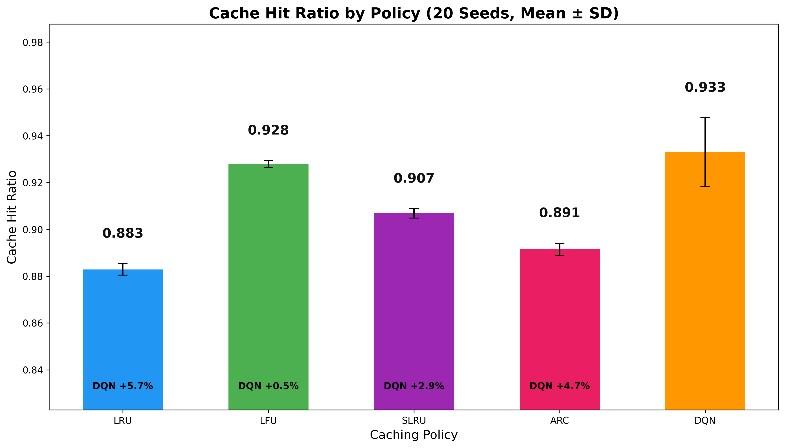
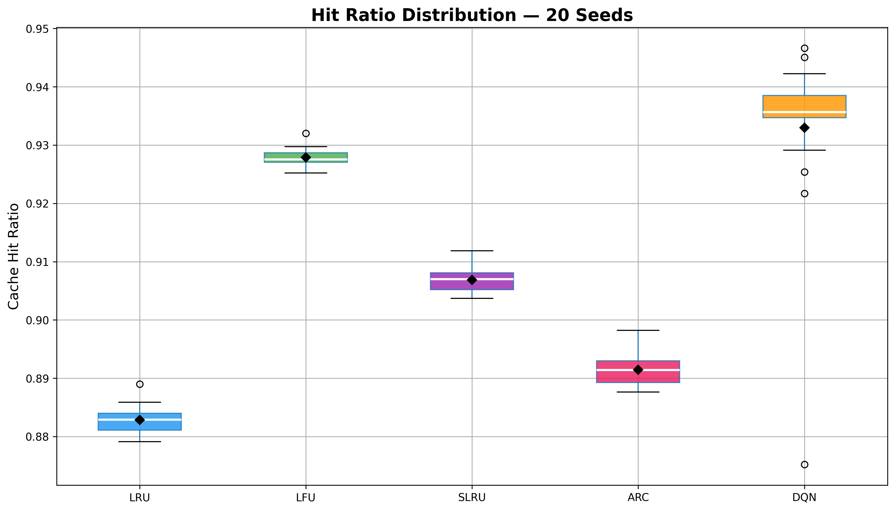
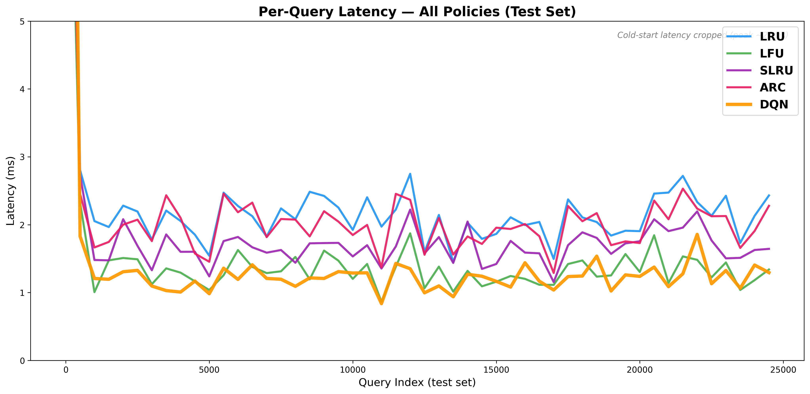
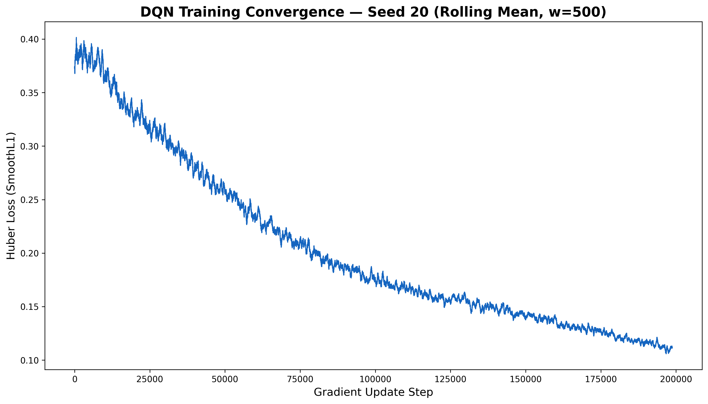
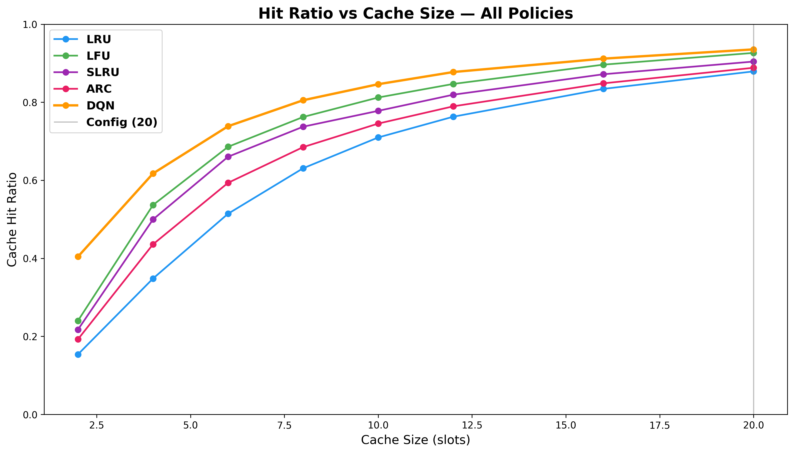
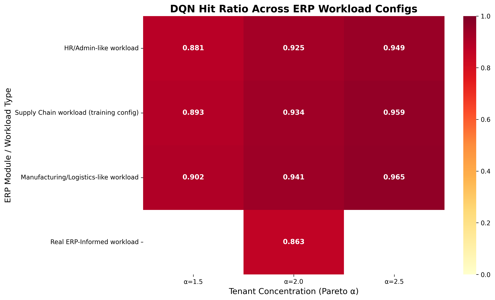

# Proactive Cache Optimization in Enterprise Systems Through Double Deep Reinforcement Learning


This repository contains the source code, environment simulations, and experimental data for the paper **"Proactive Cache Optimization in Enterprise Systems Through Double Deep Reinforcement Learning"**, accepted at **ICIMTech 2026**.

> This repository is provided for **Data Availability** and reproducibility purposes.

---

## Overview

Cloud-hosted Enterprise Resource Planning (ERP) systems running on multi-tenant backends regularly hit latency problems once pushed past their load envelope. Conventional cache policies like Least Recently Used (LRU) act reactively and cannot predict sequential business-logic workflows (e.g., Sales Order → Inventory → Delivery).

This project introduces a **proactive caching middleware** powered by a Double Deep Q-Network (DDQN). The agent observes an 18-dimensional state vector to predict and prefetch the next necessary entity types before the user requests them, while simultaneously handling cache evictions.

### Baselines

The repository implements and benchmarks the following caching policies within the exact same sequence generator:

| # | Policy | Type |
|---|--------|------|
| 1 | **LRU** — Least Recently Used | Reactive |
| 2 | **LFU** — Least Frequently Used | Reactive |
| 3 | **ARC** — Adaptive Replacement Cache | Reactive |
| 4 | **SLRU** — Segmented LRU | Reactive |
| 5 | **DDQN** *(Proposed)* | Proactive |

### Key Results

| Metric | Value |
|--------|-------|
| Mean Cache Hit Ratio | **93.30%** across 20 random seeds |
| Latency Reduction vs. LRU | **40.47%** reduction in mean analytical query latency |
| Generalization | Zero-shot deployment verified on Odoo 14 real-world dataset |

---

## Results & Visualizations

All figures and CSV outputs below are generated automatically and saved to the `results/` directory after a complete experimental run.

### Cache Hit Ratio

| Bar Chart | Boxplot |
|:---------:|:-------:|
|  |  |

*Mean hit ratio per policy (bar); distribution across 20 seeds (boxplot).*

### Latency & Convergence

| Latency Comparison | Training Convergence |
|:-----------------:|:-------------------:|
|  |  |

*Mean analytical query latency across policies (left); DDQN reward convergence over training episodes (right).*

### Cache Pressure & Robustness

| Cache Pressure | Robustness Heatmap |
|:--------------:|:-----------------:|
|  |  |

*Cache pressure under increasing workload intensity (left); hyperparameter sensitivity sweep (right).*

---

## Citation

If you find this repository or our paper useful in your research, please consider citing our work:

```bibtex
@inproceedings{tariono2026proactive,
  title={Proactive Cache Optimization in Enterprise Systems Through Double Deep Reinforcement Learning},
  author={Tariono, Jason Tanuwijaya and Hartono, Deliko and Setiawan, Reina},
  booktitle={2026 International Conference on Information Management and Technology (ICIMTech)},
  year={2026},
  organization={IEEE}
}
```

---

## Repository Structure

```text
├── data/                        # Transaction access traces and workload configurations
├── models/                      # Saved DDQN PyTorch model checkpoints (.pt)
├── results/                     # Experimental outputs generated after a full run
│   ├── architecture.txt         # DDQN model architecture summary
│   ├── cache_pressure.csv       # Cache pressure raw data under load
│   ├── cache_pressure.png       # Cache pressure plot
│   ├── convergence_curve.png    # Training reward convergence plot
│   ├── convergence_metrics.csv  # Per-episode convergence data
│   ├── hit_ratio_bar.png        # Mean hit ratio bar chart
│   ├── hit_ratio_boxplot.png    # Hit ratio distribution boxplot
│   ├── latency_comparison.csv   # Per-policy latency raw data
│   ├── latency_line.png         # Latency comparison line chart
│   ├── metrics.csv              # Consolidated performance metrics per seed
│   ├── overhead.csv             # DDQN inference overhead measurements
│   ├── robustness_heatmap.png   # Hyperparameter sensitivity heatmap
│   ├── robustness_sweep.csv     # Raw robustness sweep data
│   └── sensitivity_lr.csv       # Learning rate sensitivity analysis
├── src/                         # Source code for the DDQN agent, environment, and baselines
├── main.py                      # Main execution script to run training & evaluations
├── monitor_server.py            # Lightweight monitoring script for VPS deployments
├── docker-compose.yml           # Docker configuration for Redis and PostgreSQL
├── requirements.txt             # Python dependencies
└── config.py                    # Centralized hyperparameters and system configurations
```

---

## Requirements

- **Python 3.10+**
- **Docker & Docker Compose** (for local Redis and PostgreSQL instances)
- At least **2 GB RAM** and **1 GB disk space**

### Install Dependencies

```bash
pip install -r requirements.txt
```

---

## Running the Experiments

### 1. Start the Environment Backends

The environment simulates cache hits via Redis and cache misses via PostgreSQL:

```bash
docker-compose up -d
```

### 2. Run the Full Benchmark

```bash
python main.py
```

This will:
- Run preflight checks and initialize the MDP environment
- Train the DDQN agent across 20 random seeds
- Benchmark against LRU, LFU, ARC, and SLRU
- Save all results, plots, and CSV outputs to `results/`

> **Note:** A complete 20-seed run may take several hours depending on your hardware. Progress is automatically saved to `results/checkpoint.json` — simply re-run `python main.py` to resume from the last completed seed.

---

## Deployment & Resilience

Use `monitor_server.py` to track CPU, RAM, and DB connection utilization during long training runs:

```bash
python monitor_server.py
```

---

## License

The **source code** in this repository is licensed under the [MIT License](LICENSE).

The **datasets and transaction traces** in the `data/` directory are provided for research purposes under [CC BY-NC 4.0](https://creativecommons.org/licenses/by-nc/4.0/).

---

## Contact

For questions regarding the codebase, experiments, or data, open an issue or reach out to any of the authors:

- Jason Tanuwijaya Tariono — [jason.tariono@binus.ac.id](mailto:jason.tariono@binus.ac.id)
- Deliko Hartono — [deliko.hartono@binus.ac.id](mailto:deliko.hartono@binus.ac.id)
